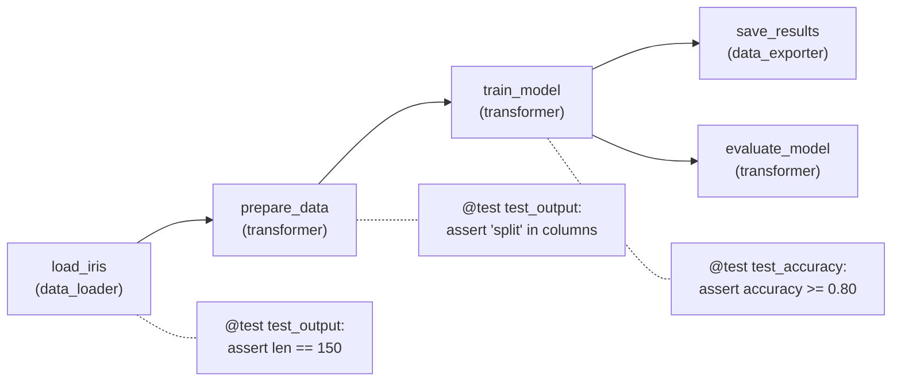

# Part C: Mage ML Pipeline Technical Reference & Solutions

## C1. Pipeline DAG Architecture & Test Attachments

### Pipeline Block Graph:


### Block Specification Table:
| Block Name | Block Type | Upstream | Downstream | Test Attached | Purpose |
| :--- | :--- | :--- | :--- | :--- | :--- |
| `load_iris` | `data_loader` | None | `prepare_data` | `test_output`: `len(df) == 150` | Ingests raw Iris dataset from scikit-learn. |
| `prepare_data` | `transformer` | `load_iris` | `train_model` | `test_output`: `'split' in df.columns` | Performs stratified 80:20 split into train (120) and test (30). |
| `train_model` | `transformer` | `prepare_data` | `save_results`, `evaluate_model` | `test_accuracy`: `accuracy >= 0.80` | Trains `DecisionTreeClassifier` with runtime `max_depth` parameter. |
| `save_results` | `data_exporter` | `train_model` | None | None | Exports predictions to `iris_predictions.csv`. |
| `evaluate_model` | `transformer` | `train_model` | None | None | Computes confusion matrix, macro precision, recall, and F1-score. |

---

## C2. Quality Gates & Runtime Parameter Experimentation

### Empirical Execution Results:
Before each execution, `iris_predictions.csv` was deleted. The pipeline was executed with `--runtime-vars '{"max_depth": X}'`:

| `max_depth` | Test Accuracy | Test Passed? ($\ge 0.80$) | `iris_predictions.csv` Created? | Behavioral Notes |
| :---: | :---: | :---: | :---: | :--- |
| **1** | **0.633** (63.3%) | **False** (Failed) | **False** (Not created) | Underfitting decision stump. Test gate aborted execution before downstream exporter ran. |
| **2** | **0.967** (96.7%) | **True** (Passed) | **True** (Created) | Meets 80% accuracy threshold. Artifact successfully generated. |
| **3** | **1.000** (100.0%) | **True** (Passed) | **True** (Created) | Default depth. Optimal classification on test split. |
| **4** | **1.000** (100.0%) | **True** (Passed) | **True** (Created) | High accuracy maintained. Output exported. |
| **5** | **1.000** (100.0%) | **True** (Passed) | **True** (Created) | Deep tree. Passes threshold and writes predictions. |

### Technical Analysis:
1. **How a failing `@test` in `train_model` stops `save_results` from running:**  
   Mage represents the workflow as a Directed Acyclic Graph (DAG) with strict topological execution order. Each block executes synchronously in its turn. When `@test test_accuracy` raises an `AssertionError` (when accuracy $< 0.80$), Mage catches the exception, flags `train_model` as `FAILED`, and immediately halts downstream execution. Because `save_results` declares `train_model` as its upstream dependency, Mage never triggers `save_results`.
2. **Why testing before saving is superior to saving first and checking afterwards:**  
   Saving before checking violates the core software engineering principle of atomic quality gates:
   - **Corrupted Artifact Prevention:** If a defective model saves predictions or model weights to disk/S3/lakehouse before validation, downstream consumer services, scoring APIs, or reporting dashboards can immediately ingest defective predictions.
   - **Idempotency & Clean State:** Halting execution prior to side-effect generation prevents pollution of production storage, avoiding messy compensation or rollback workflows.

---

## C3. Evaluation Branch (`evaluate_model`)

### Updated `metadata.yaml` Configuration:
```yaml
blocks:
- name: load_iris
  uuid: load_iris
  type: data_loader
  language: python
  upstream_blocks: []
  downstream_blocks:
  - prepare_data
- name: prepare_data
  uuid: prepare_data
  type: transformer
  language: python
  upstream_blocks:
  - load_iris
  downstream_blocks:
  - train_model
- name: train_model
  uuid: train_model
  type: transformer
  language: python
  upstream_blocks:
  - prepare_data
  downstream_blocks:
  - save_results
  - evaluate_model
- name: save_results
  uuid: save_results
  type: data_exporter
  language: python
  upstream_blocks:
  - train_model
  downstream_blocks: []
- name: evaluate_model
  uuid: evaluate_model
  type: transformer
  language: python
  upstream_blocks:
  - train_model
  downstream_blocks: []
name: iris_classifier
uuid: iris_classifier
type: python
variables:
  max_depth: 3
```

### Multi-Class Confusion Matrix (Iris 30-sample Test Set):
```text
predicted   0   1   2
actual               
0          10   0   0
1           0   9   0
2           0   0  11
```

### Metrics Table:
| Metric | Macro Score |
| :--- | :---: |
| **Accuracy** | `1.000` |
| **Precision** | `1.000` |
| **Recall** | `1.000` |
| **F1 Score** | `1.000` |

---

## C4. Custom Data Quality Transformer (`validate_iris_data`)
- **Block Name:** `validate_iris_data` (`iris_project/transformers/validate_iris_data.py`)
- **Type:** `transformer`
- **Location:** Sequenced immediately following `load_iris`
- **Quality Checks Implemented:**
  1. `assert output.isnull().sum().sum() == 0`: Ensures dataset completeness (zero missing/NULL values).
  2. `assert output['target'].nunique() == 3`: Asserts dataset validity (exactly 3 distinct biological species).
- **CI Preservation:** Confirmed that Part A Pytest CI suite (`test_split_is_80_20`) continues to execute and pass with 100% green checkmark.
